<a href="https://github.com/sindhuja-tiwari/Hierarchical-Navigable-Small-World">
  
</a>

<p align="center">
  <a href="https://github.com/sindhuja-tiwari"></a>
  <a href="https://www.linkedin.com/"></a>
</p>


### 👋 Hi there

```cpp
struct SindhujaTiwari {
    std::string_view role    = "AI / ML Engineer";
    std::string_view mission = "ML + algorithms + scalable software";

    std::array<std::string_view, 6> interests = {
        "Artificial Intelligence & Machine Learning",
        "Information Retrieval",
        "Vector Search & Approximate Nearest Neighbors",
        "High-performance C++",
        "Distributed and real-time systems",
        "Data-driven applications",
    };
};
```


### 🚀 Featured Project: Hierarchical Navigable Small World

A from-scratch **C++17 HNSW approximate nearest-neighbor search engine** built to explore vector search, graph indexing, concurrency, and performance engineering. The graph in the banner above is a tiny HNSW index running a real greedy search.

<table>
<tr>
<td valign="top" width="50%">

**Engine**
- C++17 implementation from scratch
- Multi-layer HNSW graph
- Parallel insertion
- SIMD-friendly distance computation
- Configurable `M` and `efConstruction`

</td>
<td valign="top" width="50%">

**Evaluation**
- Recall / latency / throughput benchmarking
- Compared against `hnswlib`
- SIFT-1M evaluation
- GloVe-100 evaluation

</td>
</tr>
</table>

<a href="https://github.com/sindhuja-tiwari/Hierarchical-Navigable-Small-World"></a>


### 📊 Engineering Work

| Project | Description |
|---|---|
| **HNSW / Vector Search** | High-performance approximate nearest-neighbor search in C++17 |
| **Real-Time Bidding Platform** | Real-time backend architecture and event-driven processing |
| **Machine Learning Systems** | Applied ML pipelines and intelligent decision systems |

### 🔥 Current Focus


### 🛠️ Tech Stack

<p align="center">
  
</p>

<p align="center">

`C++17` · `Python` · `Machine Learning` · `PyTorch` · `Algorithms` · `Vector Search` · `Docker` · `Git` · `Linux`

</p>


### 📈 GitHub Activity

<p align="center">
  
</p>
<p align="center">
  
  
</p>

<p align="center">
  <picture>
    <source media="(prefers-color-scheme: dark)" srcset="https://raw.githubusercontent.com/sindhuja-tiwari/sindhuja-tiwari/output/github-snake-dark.svg" />
    <source media="(prefers-color-scheme: light)" srcset="https://raw.githubusercontent.com/sindhuja-tiwari/sindhuja-tiwari/output/github-snake.svg" />
    
  </picture>
</p>
