<a href="https://github.com/sindhuja-tiwari/Hierarchical-Navigable-Small-World">
  
</a>

<p align="center">
  <a href="https://github.com/sindhuja-tiwari"></a>
  <a href="https://https://www.linkedin.com/in/sindhuja-tiwari-5a6ba82ba/"></a>
  <a href="https://sindhuja.vercel.app"></a>
  <a href="https://leetcode.com/sindhuja-tiwari"></a>
</p>


### 👋 Hi there

B.E. student in **Artificial Intelligence & Machine Learning** at Bangalore Institute of Technology
(2023–2027), based in Bengaluru. I build systems where machine learning meets real engineering
constraints: latency, concurrency, correctness and measurement.

```cpp
struct SindhujaTiwari {
    std::string_view role    = "AI / ML engineer in the making (B.E. 2027)";
    std::string_view mission = "ML + algorithms + scalable software";

    std::array<std::string_view, 6> interests = {
        "Artificial Intelligence & Machine Learning",
        "Information Retrieval",
        "Vector Search & Approximate Nearest Neighbors",
        "High-performance C++",
        "Distributed and real-time systems",
        "Data-driven applications",
    };
};
```


### 🚀 Featured Project: Hierarchical Navigable Small World

A from-scratch **C++17 HNSW approximate nearest-neighbor search engine**, built from the original
paper to explore vector search, graph indexing, concurrency and performance engineering. The graph
in the banner above is a tiny HNSW index running a real greedy search.

<table>
<tr>
<td valign="top" width="50%">

**Engine**
- Multi-layer HNSW graph, heuristic neighbour selection
- Lock-per-node parallel build
- AVX2 and NEON distance kernels
- Clean under ASan, UBSan and ThreadSanitizer; CI on Linux and macOS
- Found and fixed a concurrency effect: parallel inserts can orphan nodes, so a repair pass restores connectivity

</td>
<td valign="top" width="50%">

**Measured against `hnswlib`**
- **SIFT1M (1M vectors):** recall matches hnswlib at equal `ef` (within 0.003); 1.04x its single-thread QPS at 0.95 recall@10 (4,025 q/s)
- **GloVe-100 (1.18M vectors):** recall within 0.006 of hnswlib
- 2.2x build speedup on a 2-core laptop
- Same parameters and ground truth for both libraries

</td>
</tr>
</table>

<a href="https://github.com/sindhuja-tiwari/Hierarchical-Navigable-Small-World"></a>


### 📊 More Engineering Work

| Project | What it is | Stack |
|---|---|---|
| [**Real-Time Bidding Platform + EvidenceOps**](https://github.com/sindhuja-tiwari/Real-Time-Bidding-Platform) | Concurrent DSP auction engine (strict timeouts, idempotent APIs, rate limiting, atomic budget reservation, Kafka pipeline), plus a harness of 22 reproducible injected incidents with recorded ground truth for testing incident investigation | Python, FastAPI, Redis, Kafka, PostgreSQL, Docker |
| [**Predictive Maintenance: RUL Estimation**](https://github.com/sindhuja-tiwari/Predictive-Maintenance-Remaining-Useful-Life-Estimation) | Remaining Useful Life for turbofan engines (NASA C-MAPSS): XGBoost model, asymmetric NASA score, edge-inference service and a LangGraph maintenance copilot | Python, XGBoost, Flask, Docker |
| [**Research Paper Assistant**](https://github.com/sindhuja-tiwari/Research-Paper-Assistant) | Citation-grounded RAG agent over arXiv papers: three chunking strategies, vector search plus cross-encoder re-ranking, evaluation harness | Python, FAISS, sentence-transformers |

### 💼 Experience

- **Finrep.AI**, Full Stack Intern (Jul–Sep 2026): real-time collaboration for an AI chat platform, 20+ production bugs fixed in a Next.js frontend
- **Borderless**, Data Analyst Intern (Apr–May 2026): churn analysis for 50k+ users with SQL and Metabase; cut dashboard latency 40%
- **Navagyan**, Full Stack Intern (Mar–May 2025): cut system bugs 35% and page load time about 25% (React + Tailwind)

### 🔥 Current Focus



### 🛠️ Tech Stack

<p align="center">
  
</p>

<p align="center">

`C++17` · `Python` · `SQL` · `scikit-learn` · `XGBoost` · `RAG` · `Vector Search` · `Algorithms` · `Docker` · `Linux`

</p>
